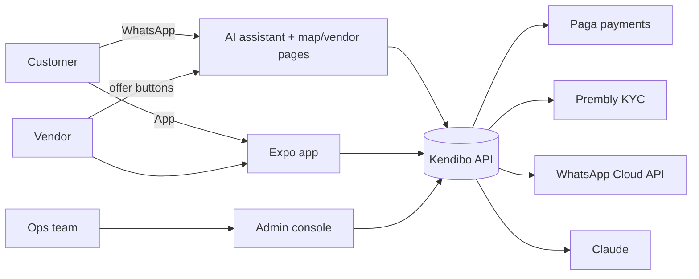

# Kendibo delivery: phase by phase

Status as of 31 Oct 2026. Each phase lists what was built, how it was verified, and what is left,
with who owns each remaining item.

## How it fits together

## Phase 1: Security foundation ✅

**Built**
- Every route requires a login unless explicitly listed as public.
- Ownership checks on bookings, payments, refunds, chat, quotes and B2B.
- One-time login codes (OTPs) are hashed and rate-limited.
- Reuse of a refresh token is detected and blocked.
- Webhooks from Paga, Sling and WhatsApp are signature-checked.
- Payouts are capped at the vendor's available balance.
- Bank-account verification can no longer invent a "verified" account name in production.

**Verified:** route-level tests in `auth`, `cors`, `wallet`, `payments.booking` and `admin-ops`.

## Phase 2: Customer and vendor flows ✅

**Built**
- Customers can book a fixed-price or quote-based job and pay through Paga only.
- Jobs are dispatched to vendors with a response deadline (SLA), then tracked through to settlement.
- Vendors are vetted per trade: each trade can require an identity level, a licence, a selfie match and a cap on concurrent jobs.
- A vendor can propose a missing trade; AI drafts it and ops approve or reject it.
- Vendors get public storefronts at `/s/<slug>` and are paid commission net of fees.

**Verified:** the `dispatch-sla`, `service-request-lifecycle`, `requests`, `provider-gallery`, `prembly-kyb-vendor-flow` and `ledger.money` tests.

## Phase 3: WhatsApp channel ✅ (needs keys to go live)

**Built**
- A Claude assistant that only acts through server-side tools.
- Photo and budget capture in the chat.
- A Google Maps location picker and a matched-vendors page, opened from WhatsApp.
- Accept and decline buttons for vendors on job offers.
- A Paga payment link sent to the customer when a vendor accepts.
- Hand-off to a human, with the menu bot as a fallback.

**Verified:** `whatsapp-ai` tests (scripted model, signed links, webhook signature, coverage area, the full map-pin-to-submit flow).

**Left (owner: you)**
- Meta WhatsApp Business account, phone number, access token, app secret and approved message templates.
- `ANTHROPIC_API_KEY` and `GOOGLE_MAPS_BROWSER_KEY`.

## Phase 4: Matching model ✅

**Built**
- Every vendor ranking shown to a customer is logged together with what happened afterwards.
- Training with `npm run ml:train`, or from the admin console. A new model is only switched on if it ranks unseen jobs better than the current one.

**Verified:** ranking and trainer tests (held-out AUC above 0.7 on synthetic data).

**Left:** it needs about 200 real bookings with outcomes before the first retrain.

## Phase 5: Admin and management systems ✅

| Page | Who can use it | What it does |
|---|---|---|
| Vendors | Trust & Safety | Review AI-drafted trade proposals, approve or reject vendor credentials, see identity-check (KYC) spend |
| Trade rules | Trust & Safety (editing needs config access) | Set identity level, licence, insurance, experience, commission, fees and job cap per trade (audited) |
| WhatsApp inbox | Support | Read hand-offs with the job the customer was booking, reply (WhatsApp only allows free replies within 24 hours of the customer's last message), hand back to the bot |
| Payouts | Finance | Balances net of fees, pay out (capped server-side), with a pause after a vendor changes bank details |
| Vendor matching | Super admin / ops | Model status, data collected, retrain |
| Integrations | Super admin / ops | Which server keys are set (fingerprints only), and any test keys in production |

**Verified:** `admin-ops` tests (role access, the 24-hour window, the payout cap, model status), plus a clean `next build`.

## Phase 6: Build health ✅

- All four projects typecheck clean. The backend passes **93 of 93 tests**, and the admin console builds for production.
- Tests are isolated by `tests/setup-env.ts`: they always use an in-memory database and blank third-party keys. `tests/hermetic.test.ts` fails the suite if that ever stops working.

## Go-live checklist (owner: you)

1. Redeploy the API on Pxxl. `api-kendibo.pxxlspace.cv` currently shows "Domain not connected".
2. Set the server environment variables in the Pxxl dashboard (the local `.env` doesn't deploy). See `docs/INTEGRATIONS.md`.
3. `PAGA_HASH_KEY`; `PREMBLY_SECRET_KEY` and `PREMBLY_APP_ID` (plus `PREMBLY_ENVIRONMENT=live` once Prembly approves live keys), then set `KYC_PROVIDER=prembly`; `SLING_API_TOKEN` and `SLING_WEBHOOK_SECRET`.
4. Give the mobile app its own ingest-only WatchUp key; it currently ships the server key.
5. Switch media storage to FTPS or S3 (`FTP_SECURE=false` sends credentials in plain text).
6. Run migrations 027 and 028 against production after reviewing them.
7. Merge the sync PRs after staging QA.
